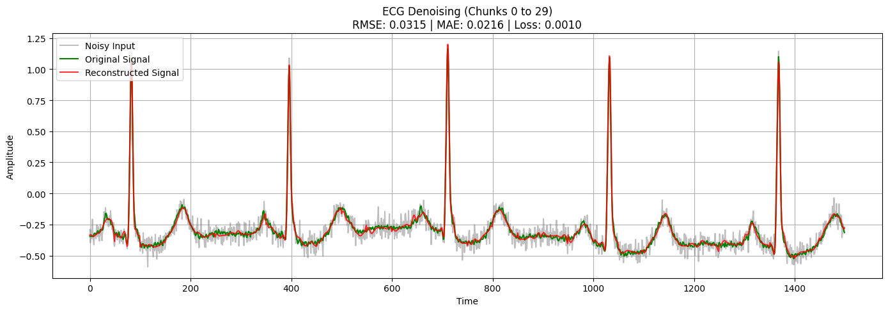

# ECG Denoising and R-Peak Detection

An ECG processing project that combines an **LSTM autoencoder** for noise removal with a **GRU classifier** for detecting windows that contain an R-peak. The repository includes the experiments, saved results, and a project report.

## What the project does

1. Read MLII lead signals from the MIT-BIH Arrhythmia dataset CSV collection.
2. Augment traces with jitter, amplitude scaling, and resampling-based time warping.
3. Train a sequence-to-sequence LSTM to reconstruct clean 50-sample windows from Gaussian-noisy inputs.
4. Generate peak labels with NeuroKit2 and local-maximum refinement, then train a GRU to classify each 50-sample window.
5. Evaluate a combined noisy ECG → LSTM denoiser → GRU peak-window classifier pipeline.

The classifier predicts **peak presence within a window**. It does not predict an exact peak timestamp or an arrhythmia diagnosis.

## Saved experimental results

These values come from the supplied notebook outputs; training has not been rerun for this repository.

| Experiment | Evaluation | Saved result |
| --- | --- | --- |
| LSTM denoising, selected batch size 32 | Test RMSE / MAE | **0.031504 / 0.021565** |
| GRU on original ECG windows | Accuracy / positive-class F1 | **96.32% / 0.8699** |
| LSTM → GRU on noisy ECG | Accuracy / positive-class F1 | **95.96% / 0.8597** |

The classification test contains 104,000 windows, including 15,944 positive windows. Peak labels are algorithm-generated, so these scores measure agreement with that labeling procedure. See [results and interpretation](reports/results.md).



## Repository contents

| Path | Purpose |
| --- | --- |
| [01_lstm_denoising.ipynb](notebooks/01_lstm_denoising.ipynb) | Denoiser training and reconstruction plots |
| [02_gru_peak_detection.ipynb](notebooks/02_gru_peak_detection.ipynb) | Peak labeling and GRU classification |
| [03_denoise_then_detect.ipynb](notebooks/03_denoise_then_detect.ipynb) | Combined inference and evaluation |
| [originals/](originals/) | Supplied notebooks with historical outputs |
| [data/patient_split.json](data/patient_split.json) | Supplied augmented-column split indices |
| [reports/project_report.pdf](reports/project_report.pdf) | Original Persian report body |
| [docs/REPRODUCIBILITY.md](docs/REPRODUCIBILITY.md) | Setup details, assumptions, and limitations |

## Getting started

Use Python 3.11 in a fresh environment. A GPU is useful for training.

```bash
git clone https://github.com/Arian-Abdollahi/ecg-denoising-r-peak-detection.git
cd ecg-denoising-r-peak-detection
python -m venv .venv
source .venv/bin/activate
python -m pip install -r requirements.txt
jupyter lab
```

On Windows, activate with `.venv\Scripts\activate`.

Download and extract the [MIT-BIH CSV dataset](https://www.kaggle.com/datasets/protobioengineering/mit-bih-arrhythmia-database-modern-2023/data) as described in [data/README.md](data/README.md). Open the notebooks in numerical order. The first two generate model files in `artifacts/`; the third requires both. Dataset files and trained weights are not included.

The provided split keeps source-record groups separate across training, validation, and test under the original sorted-file order and one-augmentation-per-record layout. The indices are positional, so preserve that order; distinct patient identities have not been independently verified.

## Scope and next steps

This is a research prototype. Priorities for a stronger evaluation are expert reference annotations, stable record-ID manifests, repeated runs, and testing on real noise. Gaussian-noise reconstruction metrics are in the source signal's amplitude units and cannot be compared directly with differently normalized datasets.

See [credits](CREDITS.md) and [verification](docs/VERIFICATION.md).
