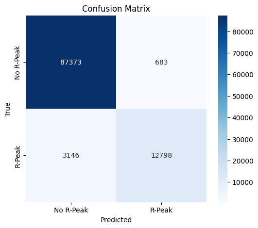
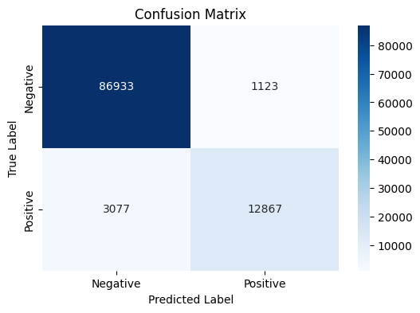

# Historical experimental results

Source: saved outputs of the supplied notebooks. These are historical observations, not a fresh benchmark.

## Denoising

- Model: LSTM(64) encoder → RepeatVector → LSTM(64) decoder → TimeDistributed Dense(1).
- Inputs: nonoverlapping 50-sample windows, Gaussian noise standard deviation 0.05.
- Optimizer: Adam, learning rate 0.001; objective: MSE.
- Batch sizes: 32, 64, 128; up to 10 epochs, early stopping patience 3.
- Selection: lowest validation loss; batch 32 was selected with validation loss 0.001305.
- Selected model test MSE 0.000992, RMSE 0.031504, MAE 0.021565.

## Peak-window classification

| Model input | Accuracy | Positive precision | Positive recall | Positive F1 |
| --- | --- | --- | --- | --- |
| Original ECG → GRU | 0.9632 | 0.9493 | 0.8027 | 0.8699 |
| Noisy ECG → LSTM → GRU | 0.9596 | 0.9197 | 0.8070 | 0.8597 |

Test support: 88,056 negative and 15,944 positive windows. GRU(64) + Dense(1, sigmoid), binary cross-entropy objective, Adam 0.001. Batch 32 had the lowest recorded validation loss (0.052334). Some original plot labels say MSE even though the classifier optimizes binary cross-entropy.

## Interpretation

Accuracy is influenced by the larger negative class; positive recall and F1 give additional context. NeuroKit2 detections, refined to a local maximum within ±100 samples at 360 Hz, supply the labels. No comparison against expert beat annotations is implemented. The combined score is not a clinically validated peak detector.

Batch candidates also have printed test scores in the original run. A future experiment should reserve the test set for a single evaluation after all model choices are fixed.
